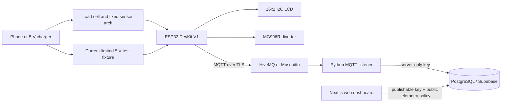

<div align="center">
  
</div>

<h1 align="center">ReGrade</h1>

<p align="center">
  <a href="https://img.shields.io/badge/Status-In%20Development-blueviolet"></a>
  <a href="https://opensource.org/licenses/MIT"></a>
</p>

<p align="center"><strong>Non-destructive diagnostics for a safer, smarter e-waste triage.</strong></p>

**Project description:** ReGrade is a capstone project exploring an affordable,
automated way to triage discarded smartphones and 5 V USB chargers. An ESP32
test station is designed to collect external weight, casing-distance,
surface-temperature, and USB-current measurements, then classify devices for
refurbishment, recycling, or safe disposal. Devices remain closed throughout
the test; batteries are never manually removed.

[Live Demo](#live-demo) · [System Architecture](#system-architecture) · [Security & Privacy](#security--privacy) · [MIT License](LICENSE)

> **Prototype safety notice:** This repository is an initial software
> prototype. Sensor acquisition requires station-specific calibration values.
> Grading thresholds and servo actuation remain disabled. Do not use this
> system to make real safety or disposal decisions until the circuit,
> calibration process, and test procedure have been reviewed and validated.

## 📌 Product Overview

### What ReGrade is designed to do

- **Inspect without teardown:** Use external measurements to screen phones and
  5 V chargers while keeping their casings intact.
- **Support consistent triage:** Apply calibrated rules to help route devices
  toward refurbishment, recycling, or safe disposal.
- **Record diagnostic outcomes:** Stream station telemetry over MQTT for
  future inventory and dashboard integrations.

### Why it matters

Manual e-waste inspection is time-consuming and inconsistent. Missed signs of
damage can put downstream workers at risk, while functional devices can be
discarded as scrap. ReGrade explores whether fast, non-destructive measurements
can help identify reuse opportunities and flag devices that need safer handling.
These measurements can indicate external signs of a fault; they do not diagnose
the internal condition of battery cells.

---

## 🚀 Live Demo

[Live demo coming soon](#live-demo)

The dashboard starter is available locally, but no hosted service is running
yet. The dashboard requires a configured Supabase project and displays an
explicit setup message until project credentials are provided.

---

## 📸 Screenshots

The dashboard is now implemented as a starter, but no genuine screenshots have
been captured for the project yet. Add reviewed dashboard and test-station
screenshots here as the prototype is built and tested.

| Dashboard / Inventory              | ReGrade Test Station                  |
| ---------------------------------- | ------------------------------------- |
| _Dashboard screenshot coming soon_ | _Test-station screenshot coming soon_ |

| Diagnostic Cycle              |
| ----------------------------- |
| _Walkthrough GIF coming soon_ |

---

## 🛠️ Tech Stack

| #   | Tool / Technology                                                             | Category                  | Description                                                                                          |
| --- | ----------------------------------------------------------------------------- | ------------------------- | ---------------------------------------------------------------------------------------------------- |
| 1   | ESP32-WROOM-32D DevKit V1                                                     | Compute & Control         | Runs the station firmware and manages sensor, UI, actuator, Wi-Fi, and MQTT interactions.            |
| 2   | PlatformIO / Arduino framework                                                | Firmware                  | Builds and uploads the embedded C/C++ firmware.                                                      |
| 3   | HX711 + 1 kg bar load cell                                                    | Physical Sensing          | Reads device weight for comparison with a model baseline.                                            |
| 4   | VL53L0X time-of-flight sensor                                                 | Physical Sensing          | Measures distance from a fixed arch to estimate device thickness and detect casing deformation.      |
| 5   | MLX90614 (GY-906 BCC)                                                         | Physical Sensing          | Reads surface temperature without contact.                                                           |
| 6   | INA219 current/voltage sensor                                                 | Electrical Diagnostics    | Measures USB input current and voltage through a reviewed, protected test fixture.                   |
| 7   | IRFZ44N MOSFET, 1N4007 diode, LM7805 buck converter, PTC fuse, power resistor | Analog & Power Protection | Planned switching, regulation, and protection components; circuit design requires review before use. |
| 8   | LM358 / TL072 active Sallen-Key low-pass filter                               | Analog Front-End          | Planned signal conditioning for the analog front-end.                                                |
| 9   | 16×2 LCD with I2C backpack                                                    | Actuation & UI            | Displays operator prompts and diagnostic status.                                                     |
| 10  | MG996R servo, tactile buttons, tri-color LEDs, buzzer                         | Actuation & UI            | Planned diverter and operator/status controls.                                                       |
| 11  | MQTT / PubSubClient                                                           | Cloud / IoT               | Transports JSON diagnostics to a HiveMQ or Mosquitto broker.                                         |
| 12  | Python / Paho MQTT                                                            | Cloud / Backend           | Receives, validates, logs, and persists diagnostic telemetry.                                        |
| 13  | Supabase PostgreSQL                                                           | Database                  | Stores station telemetry with public read-only access under RLS.                                     |
| 14  | Next.js / React                                                               | Web Dashboard             | Open station readings dashboard connected to Supabase when configured.                               |
| 15  | Node-RED / Blynk                                                              | Optional Dashboard        | Alternative dashboard tooling for future IoT monitoring workflows.                                   |

---

## 🏗️ System Architecture

The ESP32 is intended to collect external sensor readings, evaluate a validated
rule set, operate the diverter, and publish a diagnostic report. The current
firmware scaffold fails closed: unavailable readings or grading rules stop
grading, and actuator control remains a no-op.



The firmware follows an `IDLE → SCAN → GRADE → SORT → REPORT` state sequence.
The sensors provide indicators, not definitive battery-cell diagnoses. The
grading thresholds must be calibrated against a representative mock evaluation
set before grading or sorting is enabled. See
[docs/ARCHITECTURE.md](docs/ARCHITECTURE.md) and [docs/ERD.md](docs/ERD.md).
For a tracked list of what's still missing before an end-to-end demo — grading
threshold approval, sorter validation, device-model linkage, and more — see
[docs/OUTSTANDING_WORK.md](docs/OUTSTANDING_WORK.md).

### Database status

The versioned PostgreSQL migrations are in
[supabase/migrations/](supabase/migrations/); apply them to your project. The
dashboard reads station telemetry without sign-in under a public, read-only
RLS policy. The MQTT listener upserts reports into `station_telemetry` when
configured with server-only Supabase credentials.

Row Level Security remains enabled. Anyone can read station telemetry for the
open dashboard; ingestion still requires the server-only key held by the MQTT
listener. Do not include personal or confidential data in public telemetry.

---

## 🔒 Security & Privacy

- **Credentials:** Keep Wi-Fi and MQTT credentials in the ignored local
  `firmware/include/secrets.h`; never commit passwords, tokens, or certificates.
- **Transport security:** Use MQTT over TLS with a trusted broker CA certificate.
  Certificate verification must remain enabled.
- **Data minimization:** Avoid publishing personally identifying information.
  Serial or IMEI collection and retention require a privacy review before use.
- **Input validation:** The MQTT listener accepts JSON objects and rejects
  malformed JSON or non-object payloads.
- **Hardware safety:** Use a reviewed, current-limited 5 V fixture with suitable
  protection. Power the servo from an appropriate separate supply, not an ESP32
  GPIO.
- **Prototype boundary:** Do not use uncalibrated measurements for safety,
  resale, or disposal decisions.

---

## ⚙️ Getting Started & Local Setup

For the complete, step-by-step setup from a fresh clone through sensor
calibration, MQTT ingestion, Supabase, local dashboard, and Vercel deployment,
follow the **[ReGrade setup guide](docs/SETUP_GUIDE.md)**. It includes the
Windows PowerShell commands used for the prototype and troubleshooting steps.

### Prerequisites

- Git
- PlatformIO Core or the PlatformIO IDE extension
- Node.js 20.19+ or 22.13+ and npm
- Python 3.10 or newer and `pip`
- [Supabase CLI](https://supabase.com/docs/guides/cli)
- Access to a local Mosquitto broker or a configured HiveMQ broker for live
  telemetry tests

### Run the web dashboard

The Next.js dashboard runs independently of the ESP32 and MQTT broker, but
requires the Supabase project to be configured and migrated first. It reads
real database data only; it does not silently fall back to sample records.

After completing **Connect a new Supabase project**, from the repository root:

```sh
cd dashboard
npm ci
npm run dev
```

Create `dashboard/.env.local` using the steps below before starting the server.
Then open [http://localhost:3000/diagnostics](http://localhost:3000/diagnostics)
to view station readings without signing in.
Stop the development server with `Ctrl+C` in its terminal.

### Connect a new Supabase project

1. Create a Supabase project. Keep its database password private.
2. Install the Supabase CLI if needed (for example, `scoop install supabase`
   on Windows or `brew install supabase/tap/supabase` on macOS). In the
   Supabase dashboard, disable public sign-ups under **Authentication**; the
   `supabase/config.toml` setting applies to local Supabase development and
   does not change hosted-project Auth settings.
3. From the repository root, link this project and apply the migration:

   ```sh
   supabase login
   supabase link --project-ref YOUR_PROJECT_REF
   supabase db push
   ```

   The project reference is in the Supabase project URL. Review
   [the migration](supabase/migrations/20261012230000_initial_regrade_schema.sql)
   before applying it.

4. Optional for other operator features: in Supabase **Authentication → Users**, create/invite an email-and-password
   user for each dashboard operator. The migration creates a matching operator
   profile automatically when an Auth user is created.
5. In the Supabase project **Connect** dialog, copy the project URL and
   publishable key. In `dashboard/`, create local environment settings:

   ```sh
   cd dashboard
   cp .env.example .env.local
   ```

   Edit `dashboard/.env.local` and set
   `NEXT_PUBLIC_SUPABASE_URL` and `NEXT_PUBLIC_SUPABASE_PUBLISHABLE_KEY`.
   Then follow **Run the web dashboard**.

6. Open `/diagnostics` to view public station telemetry. It will be empty until
   the listener saves reports to Supabase.

Only the publishable key belongs in the dashboard environment. Never expose a
Supabase secret/service-role key through a `NEXT_PUBLIC_` variable or browser
code. Configure `SUPABASE_URL` and `SUPABASE_SERVICE_ROLE_KEY` only on the
server running the MQTT listener.

### Clone and configure

1. Clone the repository and enter the project directory:

   ```sh
   git clone https://github.com/chezca-v/regrade.git
   cd regrade
   ```

2. Configure firmware secrets by copying the example:

   ```sh
   cp firmware/include/secrets.example.h firmware/include/secrets.h
   ```

   Set the Wi-Fi and MQTT values in `firmware/include/secrets.h`. For the local
   Docker broker, set `MQTT_HOST` to the computer's LAN IPv4 address,
   `MQTT_PORT` to `1883`, and `MQTT_TLS_ENABLED` to `0`; keep the ESP32 and
   broker on the same trusted network. For remote brokers, use TLS and its CA
   certificate. Calibrate HX711 and empty-bed VL53L0X values in
   `firmware/include/regrade_config.h`. Review wiring in `circuit/`.

   For HX711 calibration, run:

   ```sh
   pio run -e esp32dev_hx711_calibrate_test --target upload
   ```

   Open the 115200-baud serial monitor, keep the platform empty for tare, then
   place a known mass and enter its grams. Copy the reported counts-per-gram
   value into `HX711_COUNTS_PER_GRAM`. For the ToF reference, run:

   ```sh
   pio run -e esp32dev_all_sensors_test --target upload
   ```

   Keep the bed empty and copy its distance in mm into
   `TOF_EMPTY_BED_DISTANCE_MM`. Rebuild the main `esp32dev` target after
   setting both values. Do not connect a device for current measurement until
   the protected USB fixture has been reviewed.

3. Build the firmware:

   ```sh
   cd firmware
   pio run -e esp32dev
   ```

   Upload only after confirming the wiring and safety review:

   ```sh
   pio run -e esp32dev --target upload
   ```

4. Set up and run the MQTT listener from the repository root:

   ```sh
   python -m venv .venv
   # Activate the virtual environment:
   # Windows PowerShell: .venv\Scripts\Activate.ps1
   # macOS/Linux:       source .venv/bin/activate
   python -m pip install -r cloud/requirements.txt
   ```

   Configure the listener. For the local Docker broker, in PowerShell set:

   ```text
   $env:MQTT_HOST = "localhost"
   $env:MQTT_PORT = "1883"
   $env:MQTT_TOPIC = "regrade/+/diagnostics"
   $env:MQTT_TLS = "false"
   $env:SUPABASE_URL = "https://your-project-ref.supabase.co"
   $env:SUPABASE_SERVICE_ROLE_KEY = "your-server-only-key"
   ```

   Keep the Supabase secret key only in this listener process environment; do
   not put it in the dashboard or Vercel browser variables. For a hosted TLS
   broker, set `MQTT_TLS=true`, `MQTT_CA_CERT` to the trusted CA certificate
   path, and provide `MQTT_USERNAME` / `MQTT_PASSWORD` as appropriate. Then run:

   ```sh
   python cloud/mqtt-listener.py
   ```

The listener logs received JSON payloads and upserts them to
`station_telemetry`. Apply the new migration before starting it. Configure
`NEXT_PUBLIC_SUPABASE_URL` and `NEXT_PUBLIC_SUPABASE_PUBLISHABLE_KEY` with the
same Supabase project in both `dashboard/.env.local` and the Vercel project
environment. The Vercel site reads the same records from Supabase without
sign-in; the MQTT listener must remain running and connected to the broker for
new reports to arrive. The dashboard diagnostics route refreshes its report
list on page load.

---

## 🧪 Testing

Build the PlatformIO project:

```sh
cd firmware
pio run
```

Check the dashboard from its directory:

```sh
cd dashboard
npm run lint
npm run build
```

Check Python syntax from the repository root:

```sh
python -m compileall -q cloud
```

The repository does not yet contain a firmware unit-test suite or automated
Python tests. Hardware validation and threshold calibration must be performed
with a representative mock evaluation set before enabling measurements,
grading, current loading, or servo actuation. Automated project tests will be
added as those components are implemented.

---

## 🗂️ Repository Structure

```text
regrade/
├── .github/                   # GitHub templates and CI configuration
├── cad/                       # Mechanical design files and notes
├── circuit/                   # Schematics, wiring, and electrical safety notes
├── cloud/                     # MQTT listener and Supabase telemetry ingestion
├── dashboard/                 # Next.js App Router dashboard starter
│   ├── app/                   # Pages, layout, and responsive styles
│   ├── lib/supabase/          # Browser and server Supabase clients
│   ├── proxy.ts               # Supabase Auth cookie refresh
│   └── lib/database.types.ts  # Typed database view/table definitions
├── supabase/
│   ├── config.toml            # Supabase local-project configuration
│   └── migrations/            # Versioned PostgreSQL schema and RLS policies
│   └── package.json           # Dashboard dependencies and scripts
├── docs/                      # System architecture and ERD
├── firmware/
│   ├── include/               # Pin configuration and local secrets template
│   ├── src/main.cpp           # ESP32 diagnostic state machine
│   └── platformio.ini         # PlatformIO project configuration
├── .env.example               # Example application environment settings
├── .gitignore                 # Build artifacts, dependencies, and secrets
├── LICENSE
└── README.md
```

---

## 🤝 Contributing

Contributions are welcome. Please open an issue to discuss hardware or
architecture changes before submitting a pull request, especially changes
affecting electrical safety, grading rules, or device handling.

1. Fork the project.
2. Create a feature branch: `git checkout -b feature/your-change`.
3. Make focused changes and run the relevant checks.
4. Push your branch and open a pull request.

---

## 📄 License

Distributed under the MIT License. See [LICENSE](LICENSE) for details.

---

## 👩‍💻 Meet the Team

| Team Member | Role                                              |
| ----------- | ------------------------------------------------- |
| Cessa       | Introduction, problem statement, and target scope |
| Lena        | Non-destructive hardware methodology              |

<!-- Add team members and roles as the project team is finalized. -->
