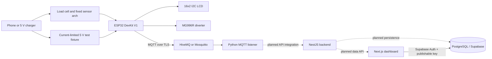

# ReGrade system architecture

ReGrade is an embedded triage prototype for smartphones and 5 V USB chargers.
The device under test remains intact throughout testing. Its external mass,
surface geometry, temperature, and USB input-current measurements are intended
to inform a locally executed grade and a physical diverter action. The initial
firmware provides the control-flow scaffold; it deliberately refuses to grade
or sort while acquisition or calibrated rules are unavailable.

## System data flow

The device model and its calibrated baseline must be identified before
measurement interpretation. Firmware-side sensor acquisition, model
identification, rule-set retrieval, and validated thresholds remain
implementation work. A failed or incomplete reading produces telemetry and
does not actuate the sorter.

## Components

| Layer | Component | Responsibility |
| --- | --- | --- |
| Control | ESP32-WROOM-32D / PlatformIO | Non-blocking session state machine, local UI, MQTT telemetry |
| Weight | Load cell + HX711 | Device mass after calibration |
| Geometry | VL53L0X ToF | External thickness estimate against a fixed bed reference |
| Temperature | MLX90614 | Non-contact surface temperature and rise |
| Electrical | INA219 and protected 5 V fixture | Input voltage/current measurement; fixture design is not enabled by this firmware |
| UI/sorting | 16x2 I2C LCD, button, MG996R | Operator prompt and grade-bin diverter |
| Messaging | MQTT over TLS | Diagnostic telemetry transport |
| Logging | `cloud/mqtt-listener.py` | Validate JSON object shape and log received telemetry |
| Dashboard | `dashboard/` (Next.js, TypeScript) | Authenticated read-only interface for Supabase; requires project configuration |
| Persistence/API | NestJS and PostgreSQL/Supabase | Planned integration; not implemented by this scaffold |

The current UI design uses a 16x2 LCD with an I2C backpack. Confirm its I2C
address and wiring on the assembled hardware. LM358/TL072 filter circuitry and
IRFZ44N/load design require a reviewed schematic before use; they are not
software substitutes for a properly isolated, current-limited fixture.

## Firmware states

1. **IDLE**: wait for a debounced start-button press.
2. **SCAN**: attempt external sensor acquisition. Missing or uncalibrated
   readings end the session without a grade or servo action.
3. **GRADE**: require a valid approved threshold set, then classify.
4. **SORT**: move the diverter only after a valid grade; wait without blocking.
5. **REPORT**: publish diagnostic status when the broker is available and show
   the outcome on the LCD.

The loop services Wi-Fi/MQTT and the button alongside the state machine. MQTT
is configured for TLS using a broker CA certificate. Reports are currently
best-effort; durable buffering and confirmed delivery have not been added.

## Telemetry

The firmware publishes JSON at `regrade/<station-id>/diagnostics`. Fields
include `session_id`, `station_id`, `status`, `grade`, `health_score`,
`duration_ms`, `sort_success`, `fault`, and a `readings` object. An unavailable
measurement is serialized as `null`; consumers must not interpret null as a
passing measurement. The cloud listener currently logs payloads only and does
not mutate a database or issue commands to the ESP32. The dashboard queries
the `dashboard_diagnostics` Supabase view using an authenticated session. It
does not yet consume listener output or a backend API, so the MQTT listener
must not be assumed to populate database records.

The Supabase migration enables Row Level Security, grants authenticated users
read-only access to operational data, and withholds device serial/IMEI values
from the dashboard's database role. Public sign-ups are disabled. The current
policies model a single shared operator workspace, not multi-tenant access.

## Safety and deployment boundaries

- No firmware operation opens a device or removes a battery.
- Sensor signals indicate possible external signs of a fault; they do not
  diagnose individual battery cells.
- No load/current stimulus is implemented. The USB test fixture must be
  independently reviewed for 5 V limits, current limiting, overcurrent
  shutdown, fuse protection, isolation, thermal dissipation, and safe failure.
- Power the MG996R from a suitable separate supply and share ground as required
  by the reviewed design; never power it from an ESP32 GPIO.
- Do not rely on the default example configuration. Supply Wi-Fi/MQTT
  credentials and a trusted CA certificate outside version control.
- Validate grading rules against a representative mock evaluation set and
  obtain a hardware safety review before enabling actuation.
