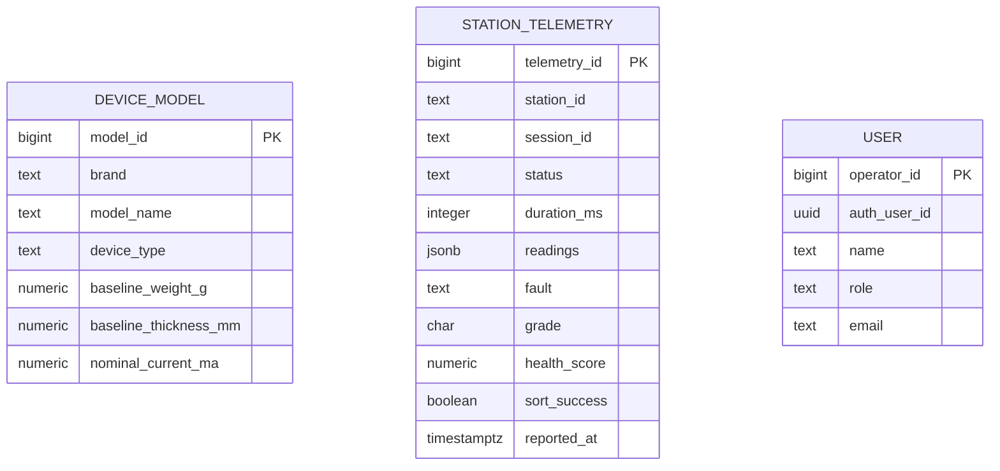

# ReGrade data model

The canonical PostgreSQL schema is the versioned migration set in
`supabase/migrations/`. An earlier migration (`20261012230000`) modeled a
normalized triage pipeline (sessions, per-sensor readings, grade results, sort
actions, bins, alerts), but nothing in `firmware/` or `cloud/` ever wrote to
those tables: the firmware publishes one flat diagnostic report per session
over MQTT, and the listener persists it as a single row. That normalized
schema was dropped (`20261020020000`) because it was permanently empty and the
dashboard code that queried it always fell back to placeholder data. The
schema below is what is actually populated end to end.

`DEVICE_MODEL`, `STATION_TELEMETRY`, and `USER` (`app_user` in SQL) have no
foreign-key relationship to each other today: a diagnostic report identifies
its station and session but not which `device_model` was under test, so there
is nothing yet to join on.

## Entities

- **DEVICE_MODEL**: `model_id` (PK), brand, model name, device type
  (`phone`/`charger`), baseline weight, optional baseline thickness, nominal
  current. Populated by the reference-weights seed migration and read by the
  Reference Weights screen; not yet referenced by telemetry.
- **STATION_TELEMETRY**: `telemetry_id` (PK), `station_id`, `session_id`
  (unique together), `status`, `duration_ms`, `readings` (jsonb: `weight_g`,
  `thickness_mm`, `current_ma`, `surface_temp_c`, `temperature_rise_c`, each
  nullable), `fault`, `grade` (`A`/`B`/`C`/`D`, nullable), `health_score`
  (0-100, nullable), `sort_success` (nullable), `reported_at`. This is the one
  table the firmware → MQTT → listener pipeline actually writes.
- **USER**: `operator_id` (PK), Supabase `auth_user_id` (FK), name, role, email.
  This maps to `app_user` in the SQL schema and is provisioned when an Auth
  user is created; unrelated to telemetry.

`grade` and `health_score` are null until a session actually reaches
`status = "graded"`; today the firmware always ends sessions at
`calibration_required` because no approved threshold set is loaded yet (see
`firmware/src/main.cpp`'s `loadThresholds`). `sort_success` stays `false`
because sorter actuation is an intentional non-actuating stub.

## Implementation notes

Row Level Security limits `station_telemetry` ingestion to the server-only
service-role key used by `cloud/mqtt-listener.py`; both `anon` and
`authenticated` have read-only access. `device_model` and `app_user` keep
their original authenticated-only read policies. Access control, retention,
and privacy requirements still require review. A future migration should add
a foreign key from `station_telemetry` to `device_model` (and have firmware
report a model identifier) before per-model grading context can be shown in
the dashboard.
