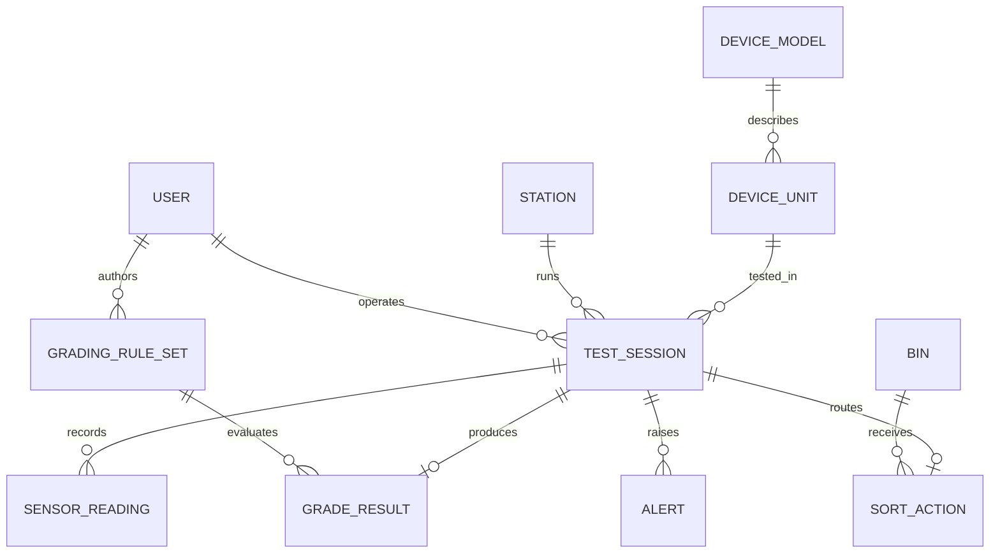

# ReGrade data model

The canonical PostgreSQL schema is the versioned migration in
`supabase/migrations/`. It covers inventory, diagnostic history, grading rules,
sorting actions, and safety alerts. The conceptual ERD below reflects the
project model. `USER` is represented in SQL as `app_user` to avoid using a SQL
keyword as a table name; it is linked to Supabase Auth.

## Entities

- **DEVICE_MODEL**: `model_id` (PK), brand, model name, device type
  (`phone`/`charger`), baseline weight, optional baseline thickness, nominal
  current.
- **DEVICE_UNIT**: `unit_id` (PK), `model_id` (FK), optional serial/IMEI,
  received timestamp, source note.
- **TEST_SESSION**: `session_id` (PK), unit/station/operator FKs, test mode,
  start timestamp, duration, status. Multiple sessions per unit allow retests.
- **SENSOR_READING**: `reading_id` (PK), session FK, sensor type, numeric value,
  unit, sample timestamp.
- **GRADE_RESULT**: `result_id` (PK), unique session FK, grade A/B/C/D, four
  diagnostic flags, health score, grading-rule version FK.
- **GRADING_RULE_SET**: `rule_version_id` (PK), weight/thickness/current/
  temperature thresholds, creating user FK, creation timestamp, active flag.
- **SORT_ACTION**: `sort_id` (PK), unique session FK, bin FK, servo angle,
  execution timestamp, success flag.
- **BIN**: `bin_id` (PK), label, grade category, capacity.
- **STATION**: `station_id` (PK), name, firmware version, last-seen timestamp.
- **USER**: `operator_id` (PK), Supabase `auth_user_id` (FK), name, role, email.
  This maps to `app_user` in the SQL schema and is provisioned when an Auth
  user is created.
- **ALERT**: `alert_id` (PK), session FK, type, severity, message, timestamp.

Phone and charger variants are represented by `DEVICE_MODEL.device_type`; no
separate subtype tables are needed. The ERD's 1-to-1 grade and sort relations
are enforced with unique `session_id` constraints. A diagnostic session that
does not complete may have no grade or sort row.

## Implementation notes

The migration is not deployed until it is pushed to a Supabase project. Row
Level Security limits data access to authenticated users; the current role
policies treat authenticated accounts as operators in one shared project
workspace. Serial/IMEI fields are not granted to the dashboard's authenticated
role. Access control, retention, privacy requirements, grading-rule activation
invariants, and production migration strategy still require review. Rule values
must be calibrated and versioned before firmware grading is enabled.
